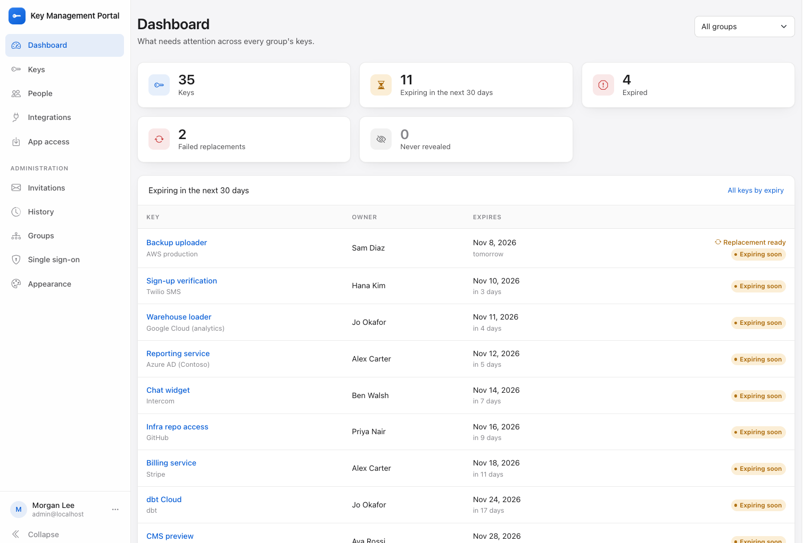
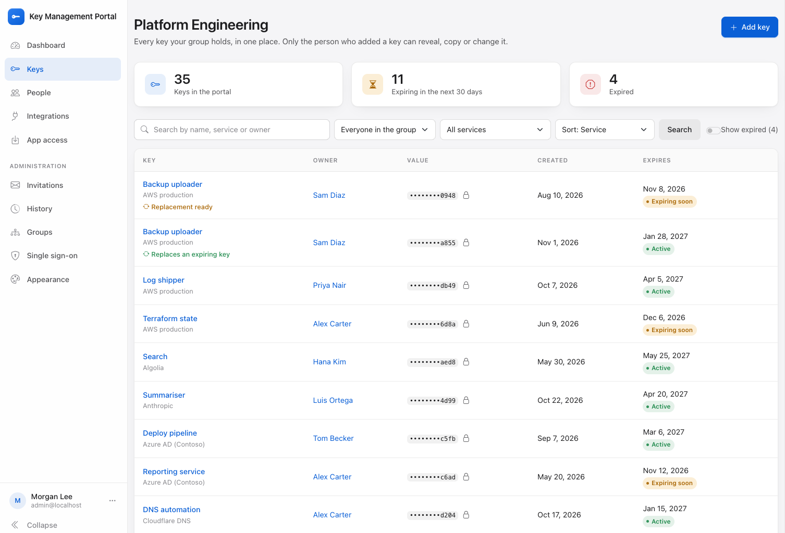
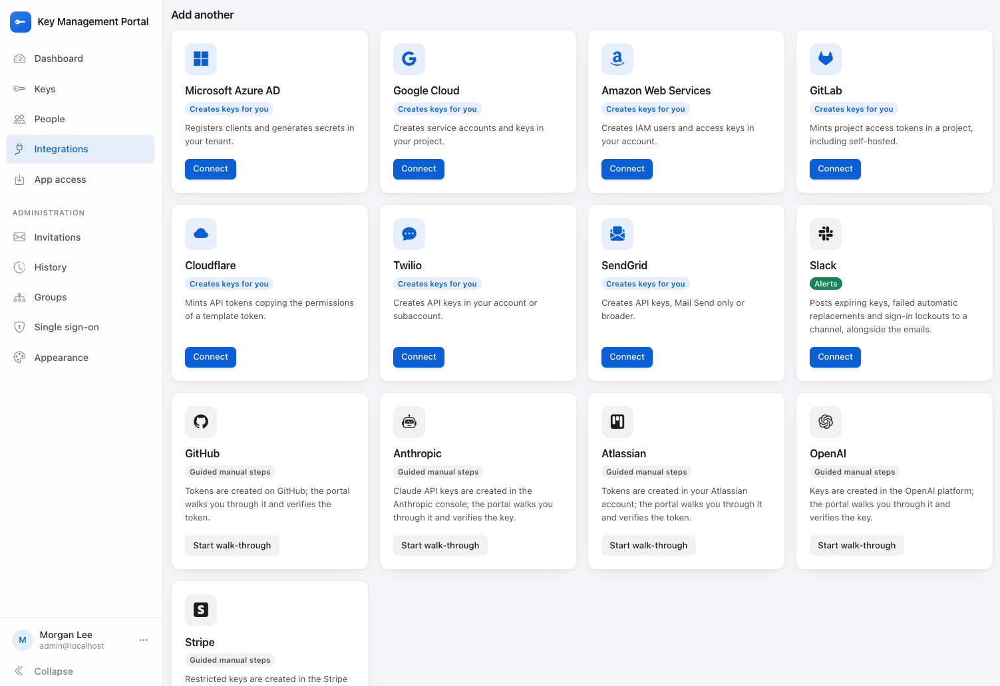
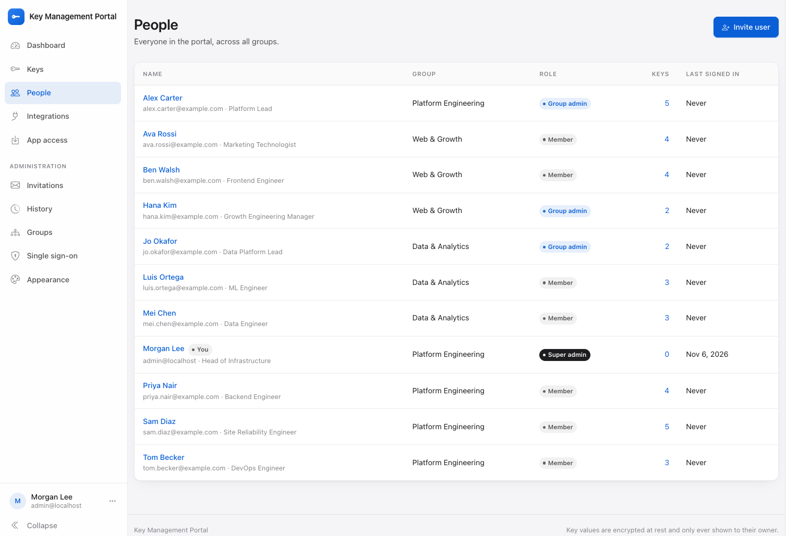
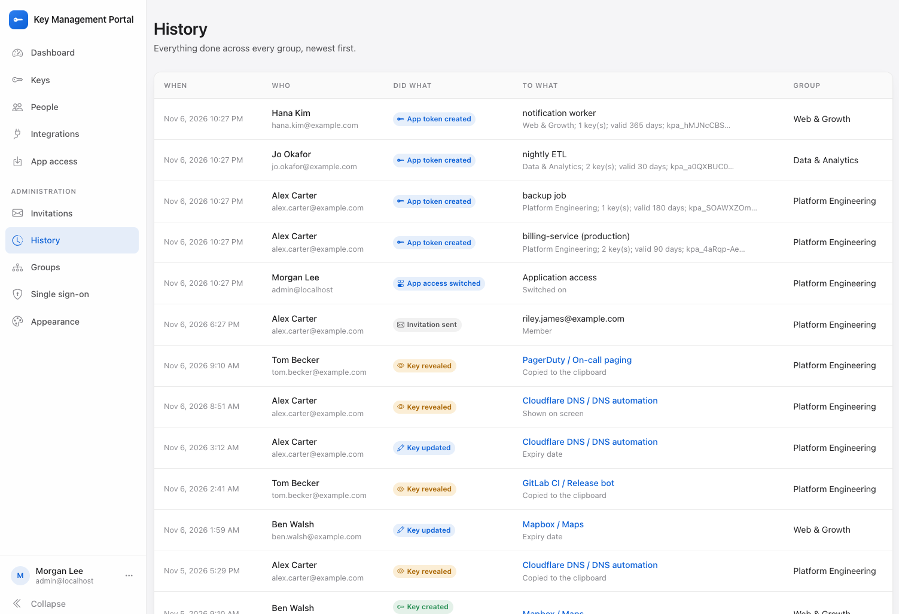

<p align="center">
  
</p>

<h3 align="center">Every API key and secret your team uses — stored safely, rotated automatically, delivered to your apps.</h3>

<p align="center">
  <a href="https://github.com/sid44-tech/api-key-portal/actions/workflows/build.yml"></a>
  
  
  
  <a href="LICENSE"></a>
</p>

<p align="center">
  <a href="#-quick-start"><b>Quick start</b></a> ·
  <a href="#-documentation"><b>Docs</b></a> ·
  <a href="docs/integrations.md"><b>Integrations</b></a> ·
  <a href="docs/app-access.md"><b>App access API</b></a> ·
  <a href="docs/security.md"><b>Security</b></a>
</p>

---

## ✨ Why Key Management Portal

> Keys live in chat threads, spreadsheets and people's heads — until one expires in production.
> This portal gives your team **one encrypted home** for every key, **creates and rotates** them in
> your cloud providers, and **hands the fresh value to your apps** automatically.

<table>
<tr>
<td width="50%" valign="top">

### 🔐 Store
Every key in one place — service, owner, dates, notes. **AES-256-GCM** encryption at rest,
owner-only reveal, and every reveal recorded.

</td>
<td width="50%" valign="top">

### ⚡ Create
One-click keys in **Azure AD, Google Cloud, AWS, GitLab, Cloudflare, Twilio and SendGrid**, plus
verified walk-throughs for GitHub, Anthropic, Atlassian, OpenAI and Stripe.

</td>
</tr>
<tr>
<td valign="top">

### 🔄 Automate
Expiring keys are **replaced ahead of time**, and the old key is deleted at the provider. Apps
read the current value over a **scoped token API**.

</td>
<td valign="top">

### 🛡️ Control
Groups and roles, invitation-only sign-up, **two-factor and SSO**, Teams/Slack alerts, a
dashboard, history and a full audit trail.

</td>
</tr>
</table>

## 📸 Screenshots

<p align="center">
  
  <br><sub><b>Dashboard</b> — expiring keys, failed replacements and keys nobody has looked at, per group</sub>
</p>

<table>
<tr>
<td width="50%" align="center"><br><sub><b>Keys</b> — search, filter and reveal on demand</sub></td>
<td width="50%" align="center"><br><sub><b>Integrations</b> — connect providers once, create keys in one click</sub></td>
</tr>
<tr>
<td align="center"><br><sub><b>People</b> — groups, roles and who holds what</sub></td>
<td align="center"><br><sub><b>History</b> — who did what, mirrored to the audit log</sub></td>
</tr>
</table>

<sub>Built with Java 25 · Spring Boot 4.1 · Spring Security · Spring Data JPA · Flyway · Thymeleaf · Bootstrap 5 — light and dark themes, custom branding.</sub>

## 🚀 Quick start

**One container, database included** (needs Docker):

```bash
echo "PORTAL_ENCRYPTION_KEY=$(openssl rand -base64 32)" > .env   # keep a copy somewhere safe
docker compose -f docker-compose.allinone.yml up -d
docker compose -f docker-compose.allinone.yml logs | grep "One-time password"
```

**Or from source** (needs JDK 25): copy `.env.example` to `.env`, set `PORTAL_ENCRYPTION_KEY`, then
run `./mvnw spring-boot:run`.

Open <http://localhost:8080> and sign in as `admin@localhost` with the one-time password from the
log. You'll be asked to change it, then you can invite everyone else under **Invitations**.

> **Keep the encryption key safe and backed up, separately from the database.** Nothing stored can
> be decrypted without it.

## 📚 Documentation

| | Guide | What's in it |
|---|---|---|
| ⚙️ | [Configuration and operations](docs/configuration.md) | Every setting, rotating the encryption key, backup and restore, reverse proxy and HTTPS, PostgreSQL |
| 🐳 | [Deployment](docs/deployment.md) | Jar, container with your own database, all-in-one container, published images, health checks |
| 👥 | [Accounts and administration](docs/administration.md) | Groups and roles, invitations, history, two-factor, single sign-on, look and feel |
| 🔑 | [Keys, reminders and replacement](docs/keys.md) | Dashboard, expiry reminders, Teams/Slack alerts, automatic key replacement |
| 🔌 | [Service integrations](docs/integrations.md) | Setting up each provider, and the guided walk-throughs |
| 🤖 | [App access](docs/app-access.md) | Letting applications read keys over the API with scoped tokens |
| 🛡️ | [Security and audit](docs/security.md) | Security design notes, logging and the audit trail |

## 🧪 Tests

```bash
./mvnw verify
```

Tests use a throwaway SQLite database under `target/` — no `.env` needed. Coverage lands in
`target/site/jacoco/index.html`.

## 🗺️ Roadmap

**Housekeeping**

- **Publish a release**: bump the version to 2.0.0 and tag `v2.0.0`, so the published images include
  the current work
- **Dependabot** for Maven dependencies and GitHub Actions
- **Test against PostgreSQL**: run part of the suite against a real PostgreSQL, for example with Testcontainers

**Features**

- **More providers**
  - GitLab group access tokens, alongside today's project tokens
- **App access follow-ups**: a lockout for repeated bad tokens; a command-line tool if there's demand

## 📄 License

[MIT](LICENSE) © 2021 Sid Bhat
