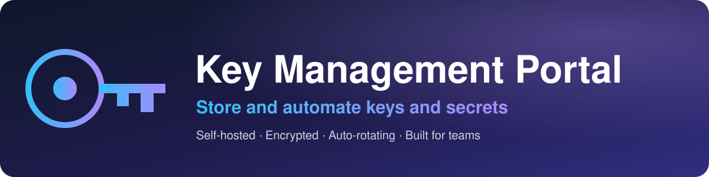

<p align="center"><a href="../README.md"></a></p>

<p align="center"><sub><a href="../README.md">🏠 Home</a> · <a href="configuration.md">⚙️ Configuration</a> · <a href="deployment.md">🐳 Deployment</a> · <a href="administration.md">👥 Administration</a> · <a href="keys.md">🔑 Keys</a> · <a href="integrations.md">🔌 Integrations</a> · <b>🤖 App access</b> · <a href="security.md">🛡️ Security</a></sub></p>

# 🤖 App access: letting applications read keys

App access lets an application fetch the **current** value of specific keys over a small HTTP API,
using a token. When a key is replaced, automatically or by hand, the app gets the new value
through the same token and reference. Nobody has to copy anything.

It is **off by default**, and only a super admin can switch it on.

## Who can do what

| | Super admin | Group admin | Member |
|---|---|---|---|
| Switch app access on or off for the whole portal | ✅ | — | — |
| Create app tokens | Any group | Own group | — |
| Delete app tokens | Any group | Own group | — |
| See that tokens exist (name, keys, expiry, last use) | All groups | Own group | Own group, read-only |
| See a token after it was created | — | — | — |

A token is shown **once**, on the page right after it is created. Only its SHA-256 hash is stored,
so nobody can see it again, including admins. While app access is switched off, every token is
refused and no new ones can be created. Existing tokens are kept, and can still be deleted.

## Setting it up

1. **Switch it on:** a super admin opens **App access** and chooses **Switch on**.
2. **Create a token:** a group admin opens **App access → New app token**, names it after the app
   (e.g. `billing-service (production)`), picks how long it lasts (30–365 days) and ticks the
   keys the app needs. Any key in the group can be chosen, whoever owns it.
3. **Store it in the app:** copy the token (it starts with `kpa_`) into the app's own secret store,
   such as an environment variable, a vault or CI secrets. Note each key's **reference**, shown
   on the same page and on the App access list.

Create one token per app, covering only the keys that app uses. That way deleting one token
affects only one app.

## The API

Send the token as a bearer token on every request. There is no session or cookie.

```bash
# What this token can read (no values)
curl -H "Authorization: Bearer $KEYPORTAL_TOKEN" https://portal.example.com/api/v1/keys

# The current value behind reference 12
curl -H "Authorization: Bearer $KEYPORTAL_TOKEN" https://portal.example.com/api/v1/keys/12
```

```json
{"ref": 12, "keyId": 87, "name": "Prod secret", "service": "Stripe",
 "expiresOn": "2027-02-01", "value": "sk_live_..."}
```

- **`ref`:** the stable reference to configure the app with. It never changes.
- **`keyId`:** the key currently behind the reference. It changes after a rotation.
- Responses are sent with `Cache-Control: no-store`.

| Status | `error` | Meaning |
|---|---|---|
| 401 | `invalid_token` | Missing, unknown, expired or deleted token |
| 403 | `api_access_disabled` | A super admin has switched app access off |
| 403 | `out_of_scope` | The key has moved to another group |
| 404 | `unknown_reference` / `key_gone` | The token has no such reference, or the key was deleted |
| 410 | `key_revoked` | The key has been deleted at its provider |

### Loading keys into environment variables

No extra tool is needed. For example, at container start:

```bash
#!/bin/sh
set -eu
fetch() { curl -fsS -H "Authorization: Bearer $KEYPORTAL_TOKEN" \
  "$KEYPORTAL_URL/api/v1/keys/$1" | sed -E 's/.*"value":"([^"]*)".*/\1/'; }
export STRIPE_API_KEY="$(fetch 12)"
exec "$@"
```

(Use `jq -r .value` instead of `sed` if `jq` is available, especially for values with quotes or
backslashes.)

## How rotation reaches the app

- **Azure, Google Cloud, AWS, Twilio and SendGrid:** the replacement is minted a week before the
  old key is retired, and both work during that week. An app that re-reads its keys on start-up,
  or once a day, switches over with no downtime.
- **GitLab:** the old token stops working the moment the new one is issued. Apps should fetch the
  key again when a request to GitLab is rejected.
- **Deleting the old key:** this doesn't break the reference. Grants move to the replacement. If
  a key is deleted with no replacement, it is removed from the tokens that covered it.

## What gets recorded

- **Audit log:** every read is written to the audit log (`app_key_read`), with the token's
  first characters and the caller's address. So are refusals.
- **Key history:** each key's history gets one **"Key read by an app"** entry each time an app picks up a *new*
  value: its first read, and the first read after each rotation. Polling doesn't flood it.
- **App access page:** shows each token's last use and each key's last read.

## Good practice

- Use HTTPS. The token is a bearer credential (see
  [Behind a reverse proxy and HTTPS](configuration.md#behind-a-reverse-proxy-and-https)).
- Prefer short validities, and delete tokens for apps that are retired.
- If a token leaks, delete it on the App access page. The app is refused from its next request.
  For a wider incident, a super admin can switch app access off for everyone in one click.

## Not yet included

- **No lockout** on repeated bad tokens. Tokens are 256-bit random values and can't realistically
  be guessed, but a lockout is planned.
- **No command-line tool:** the API and the snippet above cover the same ground for now.
